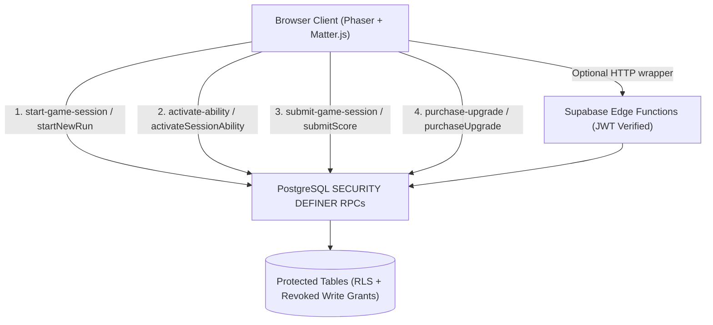

# Ball Rush — Anti-Cheat & Server-Authoritative Architecture

## 1. Threat Model & Core Principle

Every browser client is treated as untrusted. A player can open Developer Tools, execute arbitrary JavaScript, mutate `window` or `localStorage`, intercept network traffic, or call Supabase REST and RPC endpoints directly.

**Security Boundary:**
- **Client (`src/game/**`, `src/ui/**`):** Provisional presentation, local 60 FPS Matter.js soft-body physics, optimistic UI feedback, and non-authoritative local cache (`localStorage`).
- **Backend (`supabase/migrations/**`, `supabase/functions/**`):** Authoritative source of truth for game sessions, accepted leaderboard scores, coin balances, upgrade levels, one-time settlement receipts, and admin actions.

---

## 2. Trusted Backend Architecture

### Database Access Controls & Grants
1. **Table Write Revocation:** `REVOKE ALL ON ALL TABLES IN SCHEMA public FROM anon, authenticated` removes direct `INSERT`, `UPDATE`, and `DELETE` privileges that were previously granted by `001_initial_schema.sql`.
2. **Granular Read & Column Grants:**
   - `public.profiles`: `SELECT (id, username, display_name, avatar_url, created_at, updated_at)` granted to `anon, authenticated`. The `email` column is revoked from table `SELECT` and resolved only via the `public.resolve_username_email(text)` RPC during login.
   - `public.scores`: `SELECT` granted to `anon, authenticated` (public leaderboard); all writes must pass through `public.record_user_score` or `public.submit_game_session`.
   - `public.user_progress`: `SELECT` granted to `authenticated` (own row via RLS); all writes must pass through `public.sync_user_progress` or `public.purchase_ability_upgrade`.
   - `public.game_sessions` & `public.economy_ledger`: `SELECT` granted to `authenticated` (own rows via RLS); all writes restricted to `SECURITY DEFINER` RPCs.
   - `public.guest_profiles` & `public.guest_scores`: No direct table grants to `anon` or `authenticated`; accessed exclusively via bounded RPCs.
3. **Admin Authorization:** Every `public.boss_*` RPC (`boss_get_dashboard_data`, `boss_update_score`, `boss_delete_score`, `boss_update_user`, `boss_reset_user_progress`, `boss_delete_user`, `boss_update_guest_score`, `boss_delete_guest_score`, `boss_update_guest`, `boss_reset_guest_progress`, `boss_delete_guest`) calls `perform public.boss_require_admin();` as its first statement, verifying membership in `public.boss_admins`.

---

## 3. Server-Authoritative Game Session Lifecycle

### A. Starting a Session (`public.start_game_session` / `start-game-session`)
- Validates caller identity (`auth.uid()` or `p_guest_id`).
- Enforces per-actor session creation rate limiting (maximum 30 sessions per minute).
- Snapshots the player's authoritative `user_progress.upgrades` at session start (`upgrades_snapshot`).
- Generates a cryptographic 128-bit session `nonce`, records `started_at`, sets `expires_at` (`now() + 12 hours`), and records `rules_version = 1`.

### B. Ability Activation (`public.activate_session_ability` / `activate-ability`)
- Requires a registered account (`auth.uid() IS NOT NULL` and `is_anonymous <> 'true'`).
- Locks the `public.game_sessions` row `FOR UPDATE` and verifies ownership, active status, and non-expiration.
- Enforces the Ball Rush rule that each ability (`swap`, `shake`, `raise`) is **one-use per run** by checking and latching `abilities_used->>ability = true`.
- Computes the authoritative maximum duration (`15000 + wallDuration * 1000` ms for Raise Walls; `5000 + shakeDuration * 500` ms for Shake) and impulse multiplier (`1.0 + shakeIntensity * 0.1`) from the session's `upgrades_snapshot`.
- Client-side `WallAnimator` and `ShakeManager` also enforce hard upper bounds (`25,000 ms` max wall hold; `10,000 ms` max shake duration; `1.5x` max impulse) so console mutations to local save state cannot create infinite durations.

### C. Ending a Session & Score Verification (`public.submit_game_session` / `public.record_user_score`)
- Locks the session and score rows `FOR UPDATE`.
- Verifies session ownership (`user_id` or `guest_id`), active status, non-expiration, and optional session `nonce`.
- Validates run metrics via `public.validate_run_metrics`:
  - Rejects negative scores, scores `> 2,000,000`, tiers outside `1..12`, or merges outside `0..50,000`.
  - Rejects any positive score with `0` merges (`score > 0 AND balls_merged = 0`).
  - Rejects scores exceeding the maximum plausible Ball Rush chain-merge ratio (`score > balls_merged * 5000 + 1000`).
- Clamps reported run duration against server wall-clock elapsed time (`now() - started_at`) when a session record is present.

### D. Honest Physics Verification Limitations
Ball Rush runs a 60 Hz soft-body physics simulation in the browser using Matter.js (`SoftBall`, `PhysicsWorld`, `MergeSystem`) with 14-particle ring bodies, internal pressure springs, and frame-rate-coupled collision callbacks.
- **Why full deterministic replay is not currently feasible on the backend:** Floating-point non-determinism across JS engines/architectures and high-frequency soft-body sub-stepping mean that re-simulating an entire run from drop coordinates inside a serverless Edge Function or PostgreSQL RPC would either diverge on legitimate runs or require prohibitive CPU time per request.
- **What is enforced:** Strict relational invariants (score-to-merge ratio, tier bounds, positive-score merge requirements, wall-clock duration clamping, one-use session receipts, and idempotent coin settlement) plus server-side risk scoring (`NORMAL`, `SUSPICIOUS`, `INVALID`).
- **What would be required for 100% cheat-proof competitive scores:** A fixed-point deterministic physics engine shared between client and a dedicated Node/Deno verification worker that replays the timestamped `[dropX, tick]` input stream against the session's seeded PRNG queue.

---

## 4. Coin Economy & Atomic Upgrade Purchases

### A. Coin Earning & Settlement (`public.boss_settle_final_score_coins`)
- Clients **cannot** pass a coin balance or coin delta to any endpoint.
- Coins are minted exclusively from finalized `public.scores` rows (`interruption_reason IS NOT NULL`) at the canonical rate:
  $$\text{credited\_coins} = \text{round}(\text{score} / 1000, 1)$$
- Each settled score row is recorded in `public.coin_settlements` with `UNIQUE (score_id)` and `UNIQUE (user_id, run_id)` constraints, preventing replay or delete-and-resubmit double-minting.
- Every coin credit is appended to the immutable `public.economy_ledger` table (`reason = 'run_settlement'`).

### B. Atomic Upgrade Purchases (`public.purchase_ability_upgrade` / `purchase-upgrade`)
- Locks the player's `public.user_progress` row `FOR UPDATE`.
- Settles any pending finalized run receipts before checking affordability.
- Verifies optimistic concurrency (`p_coin_revision = v_progress.coin_revision` and `p_expected_level = v_current_level`), preventing race conditions and double-clicks.
- Calculates the exact cost server-side (`10 * next_level` for `wallDuration` and `shakeDuration`, max level 10; `20 * next_level` for `shakeIntensity`, max level 5).
- Verifies `v_coins >= v_cost`, deducts coins, increments the upgrade level and `coin_revision`, and writes an immutable debit entry to `public.economy_ledger` (`reason = 'upgrade:' || v_upgrade`).

---

## 5. Anti-Cheat Risk Classification

During `submit_game_session`, runs are classified into three risk tiers stored on `public.game_sessions`:
- **`NORMAL`:** Run satisfies all hard invariants and statistical heuristics.
- **`SUSPICIOUS`:** Run satisfies hard invariants but triggers anomaly flags (`reported_duration_exceeds_wall_clock`, `high_merge_frequency`, or `outlier_high_score > 50,000`). The run is recorded with `risk_level = 'SUSPICIOUS'` and `risk_reasons` populated for admin review without falsely banning legitimate outlier players.
- **`INVALID`:** Run violates hard game rules (`validate_run_metrics`). The transaction raises an exception or marks the session `rejected` / `INVALID`, rejecting leaderboard insertion and coin settlement.

---

## 6. Client State Reconciliation & Production Hardening

- **Authoritative Hydration:** On load and login (`restoreAccountProgressNow` / `persistSaveToCloudNow`), `coins`, `coinRevision`, and `upgrades` in `localStorage` (`ballrush.save.v1`) are overwritten by the server's `public.user_progress` values.
- **No Production Debug Globals:** `window.__brGame`, `window.__brScene`, `window.__brModules`, `window.__brState`, and `window.__brMenu` are strictly gated behind `if (import.meta.env.DEV)` (including inside `?diag=1`). Production builds set `sourcemap: false`.
- **HTTP Security Headers:** `vercel.json` configures `Strict-Transport-Security`, `X-Content-Type-Options: nosniff`, `Referrer-Policy: strict-origin-when-cross-origin`, `Permissions-Policy`, and `Content-Security-Policy-Report-Only`.
